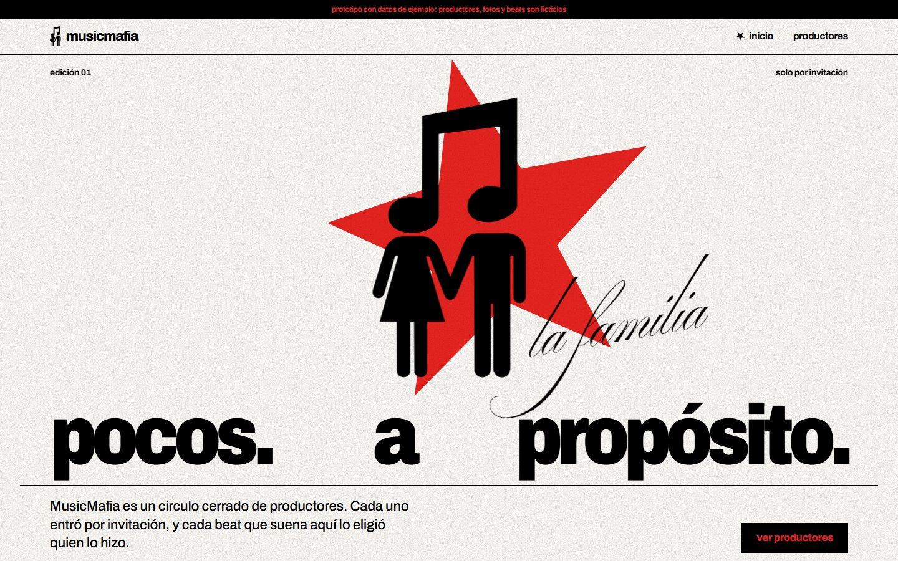
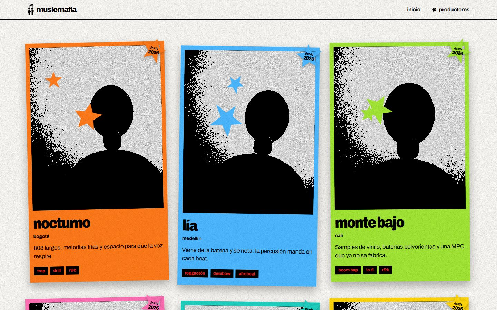
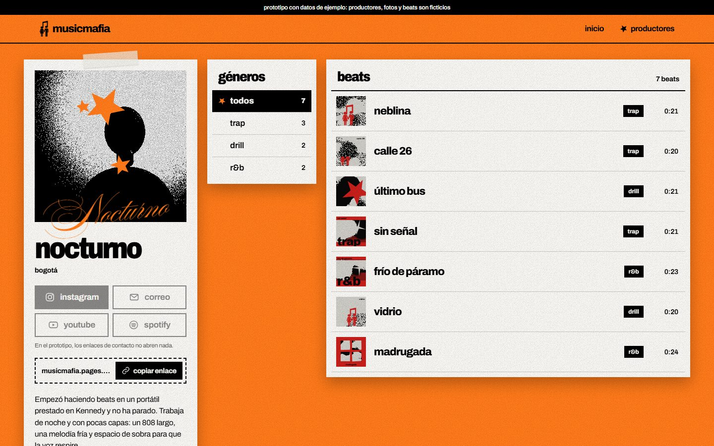
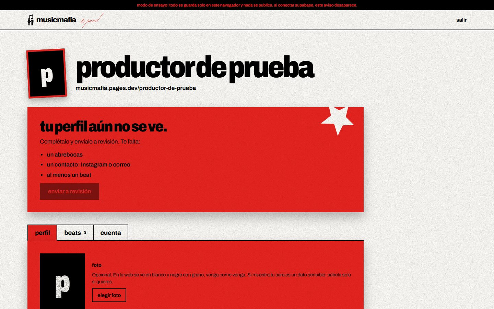
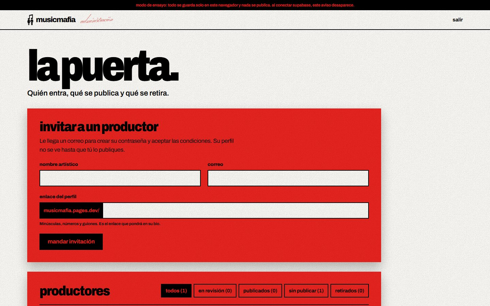
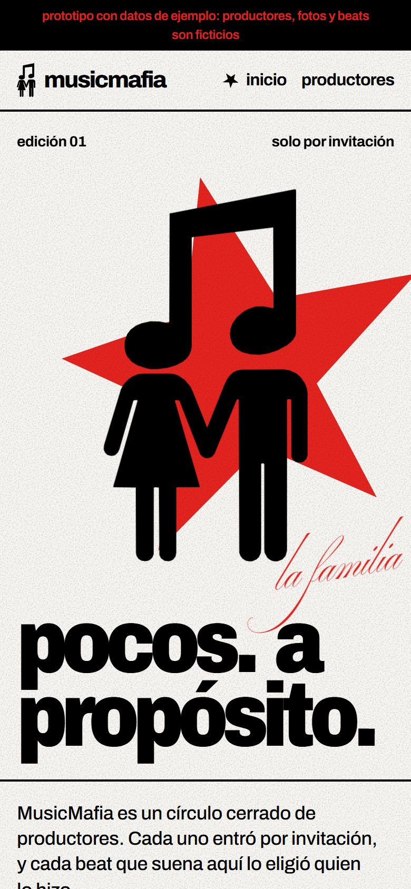
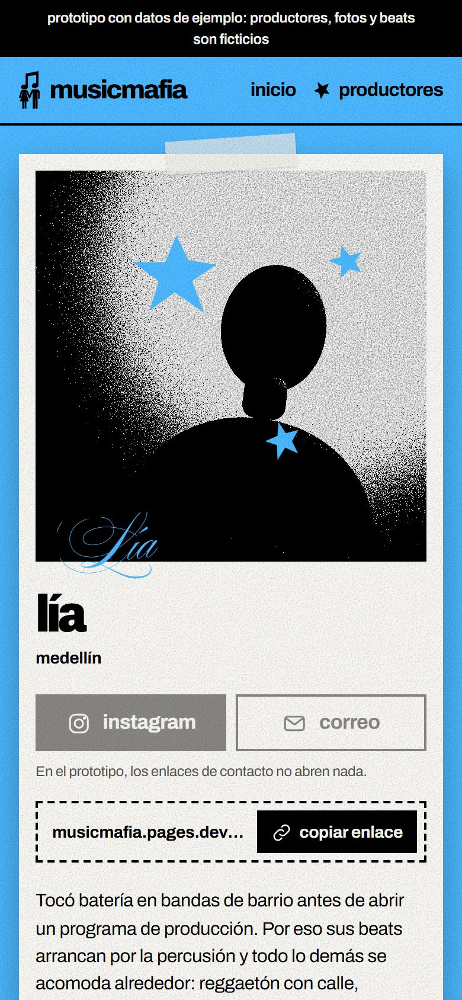
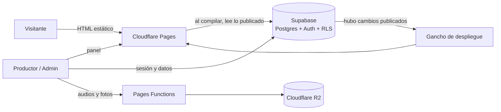

# MusicMafia

**Vitrina de beats para un círculo cerrado de productores.** Se entra solo por invitación, no hay ventas: cada productor tiene su perfil con sus beats, su color y sus enlaces de contacto.

**Web publicada:** [musicmafia.pages.dev](https://musicmafia.pages.dev)

> Este repositorio es la versión pública del proyecto. Trae todo el frontend con **datos de ejemplo**: los productores, fotos y beats que se ven aquí son ficticios, y los audios y retratos se generan por código. El backend (esquema de base de datos, permisos y funciones de servidor) y los datos reales viven en un repositorio privado. Más abajo se explica [qué se dejó fuera y por qué](#qué-no-está-en-este-repositorio).

*In English: MusicMafia is an invite-only showcase for music producers, built with Astro as a static site on Cloudflare Pages, with Supabase for accounts and data. This public repo contains the full frontend running on mock data; the backend lives in a private repo.*

---

## Capturas

| Portada | Productores |
|---|---|
|  |  |
| **Perfil de un productor** | **Panel del productor** |
|  |  |
| **Administración** | **Móvil** |
|  |   |

## Qué hace

**Para quien visita**
- Portada, listado de productores y un perfil por productor en `musicmafia.pages.dev/<enlace>`, el enlace que cada uno pone en su bio.
- Reproductor con forma de onda, filtro por género y una barra de reproducción fija en la parte de abajo.
- Cada productor elige su color: tiñe el fondo de su perfil, el marco de su foto y las portadas de los beats que no tienen la suya.
- Aviso de cookies con dos opciones reales: la medición de visitas solo se carga si el visitante la permite.

**Para el productor** (`/ingresar`, `/bienvenida`, `/panel`)
- Activa su cuenta desde la invitación, elige contraseña y acepta las condiciones. Cada casilla queda guardada con fecha, versión del documento e IP.
- Edita su perfil y sube sus beats. Las fotos se recortan y se pasan a WebP en el navegador, y la duración y la forma de onda del audio se calculan ahí mismo antes de subir.
- Envía su perfil a revisión, descarga sus datos en JSON o borra su cuenta.

**Para MusicMafia** (`/admin`)
- Invita productores, revisa perfiles, publica, devuelve con una nota o retira. También puede ocultar beats sueltos.
- Crea y quita géneros y colores. Un color solo se acepta si tiene un contraste de al menos 4,5:1 con el negro (WCAG AA).
- Ve cuándo se publicó el último cambio y puede forzar una recompilación de la web.

**Legal (Colombia)**
- Política de privacidad, política de tratamiento de datos (Ley 1581 de 2012), términos y política de cookies.
- Todo sale de un solo archivo, [`src/lib/legal.ts`](src/lib/legal.ts): plazos, proveedores y casillas de aceptación. Si cambia la versión, el panel pide a cada productor aceptar de nuevo.

## Cómo está hecho

| Parte | Tecnología |
|---|---|
| Web | [Astro 7](https://astro.build), TypeScript, CSS propio sin frameworks |
| Tipografías | Archivo y Ballet (Fontsource, servidas desde la propia web) |
| Datos y cuentas | Supabase: Postgres, Auth y seguridad a nivel de fila (RLS) |
| Audios y fotos | Cloudflare R2, servido a través de Cloudflare Pages Functions |
| Hosting | Cloudflare Pages |
| Tareas programadas | pg_cron en Supabase y GitHub Actions |

Costo de infraestructura: **0**, todo en planes gratuitos.



Algunas decisiones que vale la pena mirar:

- **Web estática que se recompila sola.** La web pública es HTML puro: rápida, sin servidor y sin costo. Cuando cambia algo publicado, una tarea de la base de datos espera a que pasen 90 segundos sin más cambios y llama al gancho de despliegue de Cloudflare. La web se actualiza en un par de minutos sin que nadie toque nada.
- **Una sola puerta a los datos, con dos versiones.** El panel solo habla con [`src/scripts/panel/datos.ts`](src/scripts/panel/datos.ts). Esa interfaz tiene una implementación real ([`real.ts`](src/scripts/panel/real.ts), contra Supabase) y una de ensayo ([`ensayo.ts`](src/scripts/panel/ensayo.ts), que guarda todo en el navegador con localStorage e IndexedDB). Por eso esta copia funciona completa sin ningún backend.
- **La seguridad está en la base de datos, no en el navegador.** Las reglas de quién puede leer y escribir qué son políticas RLS y permisos por columna en Postgres. El navegador solo pide cosas y traduce los errores. La clave de Supabase que usa el navegador es pública por diseño.
- **Medios de ejemplo generados por código.** [`scripts/genera-demo.mjs`](scripts/genera-demo.mjs) sintetiza los loops de audio (trap, drill, dembow, amapiano, lo-fi…) y dibuja retratos y portadas en SVG con estética de fotocopia. No hay ni un archivo descargado.
- **Diseño tipo fanzine.** Tres tintas, grano, estrellas recortadas y palabras repartidas a lo ancho, todo con CSS y SVG.

## Probar en local

Requiere Node 22.23 o superior (el proyecto usa Node 24, ver `.node-version`).

```bash
npm install
npm run dev
```

Abre http://localhost:4321.

- La web pública muestra los productores de ejemplo.
- El panel está en `/ingresar`. En modo de ensayo hay dos botones: **entrar como productor** y **entrar como musicmafia**. Todo lo que hagas se guarda solo en tu navegador.
- Las invitaciones de ensayo muestran el enlace de activación en pantalla en vez de mandar un correo.
- `npm run demo` vuelve a generar los audios, portadas y retratos de ejemplo.
- `npm run build` compila la web estática en `dist/`.

## Estructura

```
src/
  pages/            portada, productores, perfil /[productor], páginas legales y panel
  components/       logo, navegación, reproductor, estrellas, fotos con grano…
  layouts/          base pública, legal y panel
  scripts/          reproductor, aviso de cookies
    panel/          datos.ts (interfaz), real.ts (Supabase), ensayo.ts (navegador), archivos.ts (fotos y audio)
  data/             catálogo de ejemplo y la puerta a los datos públicos (catalogo.ts)
  lib/              datos del sitio, conexión y textos legales
  styles/           colores, tipografías y grano
public/demo/        audios, portadas y retratos de ejemplo (generados)
scripts/            generador de los medios de ejemplo
marca/              logo
```

## Qué no está en este repositorio

Esta copia se armó para enseñar el trabajo sin poner en riesgo la web que está en producción ni los datos de nadie. Se dejó fuera:

| Qué | Por qué |
|---|---|
| Esquema de la base de datos, políticas RLS y funciones de Postgres | Publicar el detalle de los permisos le facilita el trabajo a quien busque un hueco en la web real. |
| Función de servidor que manda las invitaciones | Maneja la clave secreta del proyecto. |
| Funciones que suben y sirven los archivos de R2 | Son la puerta de escritura al almacenamiento. |
| Tareas de GitHub Actions (copia de seguridad semanal) | Trabajan con la base de datos real. |
| Plantillas de correo y configuración de despliegue | Llevan cuentas y nombres de recursos de producción. |
| Datos del responsable y de contacto | En [`src/lib/sitio.ts`](src/lib/sitio.ts) son de ejemplo. Los reales están en la web publicada, como exige la ley. |
| Pruebas automáticas del backend (permisos sobre un Postgres en memoria y subida de archivos en el motor de Cloudflare) | Dependen del esquema y de las funciones. |

El historial de commits tampoco se publica: este repositorio empieza en limpio.

## Licencia

© 2026 Juan Pablo Velandia Molina. **Todos los derechos reservados.** El código se publica solo para que se pueda ver y evaluar; no se permite copiarlo, reutilizarlo ni redistribuirlo. El nombre y el logo de MusicMafia no se pueden usar. Detalles en [LICENSE](LICENSE).
